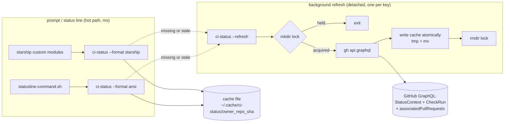
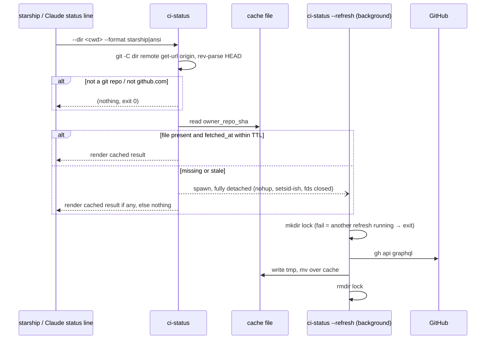
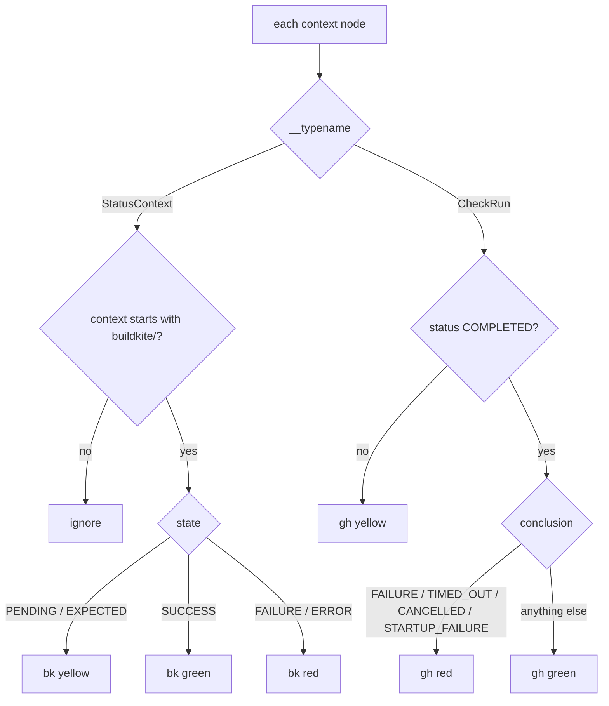

<!-- markdownlint-disable-file MD025 MD041 -->

# DESIGN-0002: CI status segment for starship and the Claude Code status line

<!--toc:start-->
<!--toc:end-->

<!--docz:overview:start-->
## Overview

A `ci-status` command that shows CI state for the current branch's HEAD
commit in two places: the starship prompt and the Claude Code status line.
It renders two segments, Buildkite (`bk ●`) and GitHub Actions (`gh ✓`),
plus the open PR number when there is one, coloured yellow / green / red
for pending / passed / failed. It reads GitHub only. Buildkite already
reports every build to GitHub as a commit status, so one `gh` GraphQL query
covers both systems with the login `gh` already has, no Buildkite token and
no 1Password call in the prompt path.

The prompt never waits on the network: the command prints only what is in
a local cache and kicks off a background refresh when the entry is missing
or stale.

<!--docz:overview:end-->

## Goals and Non-Goals

<!--docz:goals:start-->
### Goals

- Show, at a glance, whether CI on the commit I am sitting on is pending,
  green, or red, in both the shell prompt and the Claude Code status line.
- Show the open PR number for that commit.
- Hide a segment when that system has no result for the commit: homelab only
  uses Buildkite, most other repos only use Actions.
- Cost the prompt nothing measurable: about 20 ms per call, cached or not,
  far under starship's default 500 ms `command_timeout`. 20 ms is the floor
  for a bash script that starts two `git` processes and one `jq` (about
  4 ms each, measured); the network is never on this path.
- Fail silent. Offline, not logged in, not a GitHub remote, commit not pushed:
  print nothing, exit 0, never an error on the prompt.
- Fit the repo's existing patterns: a script on PATH via Home Manager
  (`temporal-oidc` is the model), starship config in `config/starship/`,
  colours from the active theme.

<!--docz:goals:end-->

<!--docz:non-goals:start-->
### Non-Goals

- Telling queued and running Buildkite builds apart. GitHub shows both as
  `PENDING`; separating them needs the Buildkite API.
- Per-step or per-job detail.
- Clickable segments. The build URL is in the cache (`targetUrl`) but v1
  does not surface it.
- Watching for new commits on the remote. The segment describes the local
  HEAD, nothing else.
- The NixOS workstation. `home/linux` does not import the common modules
  this would land in. macOS only for v1, like every other recent module.
- A herdr plugin. Plugin v1 has no sidebar or status-bar UI and no timers,
  so it cannot give the at-a-glance view; it can give an on-demand popup
  with per-pipeline detail and a Ctrl-clickable build link. That is a good
  follow-up on top of the same cache file, not part of v1.

Everything in the first three items needs a Buildkite token. Add them only
if the basic version earns it.

<!--docz:non-goals:end-->

<!--docz:background:start-->
## Background

**Where CI state lives on GitHub.** For a commit, GitHub exposes a
`statusCheckRollup` with two kinds of context:

- `StatusContext`: the legacy commit-status API. Buildkite's GitHub
  integration posts one per pipeline with `context = buildkite/<pipeline>`
  and a `targetUrl` pointing at the build. States are `EXPECTED`, `PENDING`,
  `SUCCESS`, `FAILURE`, `ERROR`.
- `CheckRun`: the Checks API, which is what GitHub Actions uses. Each job is
  a run with `status` (`QUEUED`, `IN_PROGRESS`, `COMPLETED`, …) and, once
  completed, a `conclusion` (`SUCCESS`, `FAILURE`, `NEUTRAL`, `CANCELLED`,
  `SKIPPED`, `TIMED_OUT`, `ACTION_REQUIRED`, `STARTUP_FAILURE`, `STALE`).

Checked from this machine on 2026-10-21:

| Repo | HEAD | Contexts | Rollup |
|---|---|---|---|
| `donaldgifford/homelab` (main) | `a9cc9d6` | one `StatusContext`, `buildkite/homelab`, no check runs, no PR | `FAILURE` |
| `donaldgifford/repo-guardian` | HEAD | 22 `CheckRun`, no status contexts | `SUCCESS` |

So the two fixed facts the task note relies on hold: homelab commits carry a
single `buildkite/homelab` status and no check runs. Note homelab main is
red today, which changes the "bk green on main" check in the task note to
"bk red on main" until that build is fixed.

**Latency.** `gh api graphql` round-trips in about 330 ms from here. That is
within starship's 500 ms default timeout on a good day and outside it on a
bad one, which is why the prompt path must never call `gh`.

**Existing pieces this plugs into.**

- `home/common/temporal-oidc.nix`: the pattern for a script on PATH.
  `pkgs.writeShellApplication` with `runtimeInputs`, body read from a
  sibling `.sh` file, added to `home.packages`.
- `config/starship/starship.toml`: starship 1.26, linked out of the store.
  `format` lists modules explicitly, so a custom module only appears when
  added there. Both palettes (`tokyonight_dark`, `warm_burnout_dark`) define
  `green`, `yellow`, `red`, and the theme switcher rewrites the `palette =`
  line, so custom-module styles can use those names and follow the theme.
  No `command_timeout` is set; the default 500 ms applies.
- `~/.claude/statusline-command.sh`: a plain bash file nix does not manage,
  wired in `~/.claude/settings.json` as the `statusLine` command. It reads
  the JSON on stdin, derives `cwd`, and appends `line+=` segments. It
  defines ANSI `CYAN/RED/YELLOW/DIM/RESET` and then sources
  `~/.config/themes/current/claude-colors.sh` if present to override them.
- `config/themes/`: only `warm-burnout-dark/` has a `claude-colors.sh`;
  `tokyonight-dark/` (the current theme) does not, so Claude's status line
  falls back to plain ANSI there. Neither defines `GREEN`.

**Platform quirks that shape the script.**

- GNU coreutils come first on PATH on this Mac (`stat`, `date`, `timeout`
  resolve to the nix profile). BSD and GNU `stat` take different flags, so
  the cache never relies on file mtime; the fetch time is written inside the
  file.
- `flock` is not on PATH. The per-key lock is an atomic `mkdir`.
- Flakes only see tracked files: the new `.sh` must be `git add`ed before
  the module exists.

<!--docz:background:end-->

<!--docz:detailed-design:start-->
## Detailed Design

### Components



One script, three entry points: the two render formats on the hot path and
`--refresh`, which the hot path spawns detached and which is the only thing
that talks to the network.

### Hot path



Rules on the hot path:

- Never call `gh`, never touch the network, never wait on the lock.
- Every `git` call runs with `-C "$dir"` and `core.useBuiltinFSMonitor=false`,
  as the Claude status line already does, so a monitor daemon cannot stall it.
- Spawn the refresh with stdin/stdout/stderr redirected to `/dev/null` and
  `&` under `nohup`, so neither starship nor Claude Code waits on the child.
  Both treat the module as finished when the pipe closes; an inherited stdout
  would hold it open until the fetch returns.
- A refresh is spawned when the entry is missing or `fetched_at` is older
  than the TTL. Default TTL 30 s. While a build is pending the cache goes
  stale every 30 s, so the next prompt after that re-fetches; a green or red
  result refreshes at the same cadence, which is wasteful but simple.

### Working out what to query

| Input | Source | Skip when |
|---|---|---|
| owner, name | `git remote get-url origin`, parsed from `git@github.com:o/n.git`, `ssh://git@github.com/o/n`, `https://github.com/o/n(.git)` | host is not `github.com` |
| sha | `git rev-parse HEAD` | not inside a work tree, or detached with no commit |
| cache key | `${XDG_CACHE_HOME:-$HOME/.cache}/ci-status/<owner>_<name>_<sha>` | |

The local commit may not be pushed. GitHub returns `object: null` for an
unknown sha; the refresh writes a cache entry recording that (so the prompt
does not re-spawn a refresh every render) and the renderer prints nothing.

### The query

Exactly the query from the task note, run as
`gh api graphql -f query=… -f owner= -f name= -f sha=`:

```graphql
query($owner:String!,$name:String!,$sha:GitObjectID!){
  repository(owner:$owner,name:$name){
    object(oid:$sha){ ... on Commit {
      associatedPullRequests(first:1){ nodes{ number state } }
      statusCheckRollup{ contexts(first:100){ nodes{
        __typename
        ... on StatusContext{ context state targetUrl }
        ... on CheckRun{ name status conclusion }
      }}}
    }}
  }
}
```

`gh` supplies auth from its keyring login. If `gh` is not logged in or the
call fails, the refresh writes nothing, removes its lock, and exits 0; the
prompt keeps showing the last good entry until it is overwritten.

### Classification



Buildkite: one segment per repo, from the `buildkite/*` status contexts.
If a repo ever has several pipelines, take the worst.

| Buildkite `state` | Colour |
|---|---|
| `PENDING`, `EXPECTED` | yellow |
| `SUCCESS` | green |
| `FAILURE`, `ERROR` | red |

Actions: one segment from all check runs, taking the worst run, where
red > yellow > green.

| Check run | Colour |
|---|---|
| `status` is not `COMPLETED` | yellow |
| `conclusion` in `FAILURE`, `TIMED_OUT`, `CANCELLED`, `STARTUP_FAILURE` | red |
| otherwise (`SUCCESS`, `NEUTRAL`, `SKIPPED`, …) | green |

A segment is hidden when its system contributed no node. The PR number is
shown only when the first associated PR's `state` is `OPEN`.

### Rendering

Two output formats, chosen by `--format`:

- `starship`: the script does not colour anything. Starship's custom
  modules each carry one `style`, so there is one module per segment per
  colour and the script answers `when` queries: `ci-status --is bk green`
  exits 0 when the Buildkite segment should show in green. The module's
  `command` then prints the glyph (`ci-status --format starship --segment bk`).
  Styles use the palette names `yellow`, `green`, `red`, `dimmed`, so the
  theme switcher's `palette =` rewrite recolours them. See Open Questions, Decided, for why not raw escape codes.
- `ansi`: everything on one line with escape codes, for the Claude status
  line, which already builds its line that way. Colours come from the
  variables the status-line script exports after sourcing
  `claude-colors.sh`: reuse `YELLOW` and `RED`, add `GREEN`.

Glyphs follow the task note: `bk ●`, `gh ✓`, `#228`. One glyph per system,
colour carries the state (decided, see Open Questions).

### Where it plugs in

1. **Script.** `home/common/ci-status.nix` + `home/common/ci-status/ci-status.sh`,
   mirroring `temporal-oidc`. `runtimeInputs = [ gh jq git coreutils ]`.
   Imported from `home/darwin.nix`.
2. **Starship.** `config/starship/starship.toml` gains seven
   `[custom.ci_*]` tables (`bk`/`gh` × `yellow`/`green`/`red`, plus `pr`)
   and `format` gains them after `$git_status`. Each module:
   `when = "ci-status --is bk green"`,
   `command = "ci-status --format starship --segment bk"`,
   `shell = ["bash", "--noprofile", "--norc"]` so starship does not pay for
   zsh startup, `style` a palette colour name.
3. **Claude Code.** One line in `statusline-command.sh` after the git
   branch segment:
   `ci=$(ci-status --dir "$cwd" --format ansi) && [ -n "$ci" ] && line+=" $ci"`.
   That file moves under nix (decided, see Open Questions).

<!--docz:detailed-design:end-->

<!--docz:api-changes:start-->
## API / Interface Changes

New command on PATH:

```text
ci-status [--dir <path>] --format ansi                 # whole line, escape codes
ci-status [--dir <path>] --format starship --segment bk|gh|pr   # plain glyph text
ci-status [--dir <path>] --is <bk|gh> <yellow|green|red>        # exit 0/1, for `when`
ci-status --refresh --dir <path>            # internal: fetch and write the cache
ci-status --ttl <seconds>                   # override the 30 s default
```

Exit status is 0 in every case the prompt can hit; `--format starship`
with a hidden segment prints nothing and exits 0, so starship shows nothing.

Config changes:

- `config/starship/starship.toml`: seven `[custom.ci_*]` tables, `format`
  updated.
- `~/.claude/statusline-command.sh`: one added segment.
- `config/themes/*/claude-colors.sh`: add `GREEN`; add the file to
  `tokyonight-dark/`; starship `warm_burnout_dark` green → `#b4bc78`.
- `home/darwin.nix`: one import.

<!--docz:api-changes:end-->

<!--docz:data-model:start-->
## Data Model

One JSON file per `(owner, repo, sha)` under
`${XDG_CACHE_HOME:-~/.cache}/ci-status/`:

```json
{
  "fetched_at": 1760000000,
  "found": true,
  "bk":  { "state": "green", "url": "https://buildkite.com/…/builds/1234" },
  "gh":  { "state": "yellow" },
  "pr":  { "number": 228 }
}
```

- `fetched_at` is epoch seconds written by the refresh, the only freshness
  signal (no `stat`).
- `found: false` means GitHub does not know the sha (unpushed); the
  renderer prints nothing and the hot path still honours the TTL before
  spawning another refresh.
- `bk`, `gh`, `pr` are absent when that system contributed nothing.
- `url` is stored for a future clickable segment; v1 does not read it.

Lock: `…/ci-status/<key>.lock/` directory, created with `mkdir`, removed
by the refresh on exit. A lock older than 2 minutes is treated as stale and
removed by the next refresh attempt (a killed `gh` must not wedge the key).

Growth: one small file per commit visited. A refresh that writes a new entry
also deletes entries whose `fetched_at` is older than 7 days, bounded to the
same directory, so there is no separate cleanup job.

<!--docz:data-model:end-->

<!--docz:testing:start-->
## Testing Strategy

Manual checks, matching the task note, run after `just switch`:

| Where | Expect |
|---|---|
| `~/code/homelab` on `main` | `bk` only; red today (`buildkite/homelab` is `FAILURE`), green once fixed |
| homelab branch with a build running and an open PR | yellow `bk` and `#<n>` |
| `~/code/repo-guardian` | `gh` only, green |
| a repo with an unpushed commit | nothing |
| outside a git repo | nothing |
| network off (`networksetup -setairportpower en0 off`) | last cached result, then nothing; prompt not slower |
| `gh auth logout` in a scratch shell | nothing, no error text |

Timing: `time starship module custom.ci_bk_green` and `time ci-status --format ansi`
in a cached state must be single-digit milliseconds; `starship timings`
should show the modules well under 500 ms in every state, including a cold
cache (where the hot path only spawns the refresh).

Concurrency: open three panes in the same repo and render all three prompts
at once; expect one `gh` process (`pgrep -f 'gh api graphql'`) and one lock
directory, which disappears afterwards.

Script-level: `shellcheck` via `writeShellApplication` (it runs at build
time), plus a small bats-free table test in the script's own `--self-test`
that feeds canned GraphQL JSON through the classifier and asserts the
colours for each row in the classification tables.

<!--docz:testing:end-->

<!--docz:rollout:start-->
## Migration / Rollout Plan

Order chosen for testability, not for where the segment matters most:

1. **Script and cache.** `ci-status` on PATH via Home Manager. Testable
   standalone in a terminal against homelab, repo-guardian, and a non-git
   directory, before any UI touches it.
2. **Starship.** The fast feedback loop: `starship module custom.ci_bk_green`
   renders one module on demand, `starship timings` shows the cost, and
   pressing Enter re-renders. All of the colour and cache behaviour is
   visible here.
3. **Claude Code status line.** One `line+=` segment once the script is
   known good. It only renders inside a session, needs fake stdin JSON to
   test by hand, and goes blank on any error, so it comes last.
4. **Live with it for a week.** Tune the TTL if the refresh cadence annoys
   in either direction.

Follow-up, not scheduled: a herdr plugin that reads the same cache and
opens a popup with the build detail and URL.

No data migration; the cache is disposable and the directory can be deleted
at any time.

<!--docz:rollout:end-->

<!--docz:open-questions:start-->
## Open Questions

### Decided

Calls made while writing this, each verifiable on this machine. Reopen any
of them by editing the doc.

| Topic | Decision |
|---|---|
| Starship colour | One module per segment per colour (bk/gh × yellow/green/red, plus a dim `pr`), selected with `when`. Pure starship, theme-aware; raw ANSI in `$output` lacks zsh width guards. |
| Refresh trigger | The hot path spawns a detached `--refresh` (`nohup … & disown`, verified to survive the module returning). No launchd. |
| Script location | `home/common/ci-status.nix` + `home/common/ci-status/ci-status.sh`, the `temporal-oidc` pattern, for shellcheck and `runtimeInputs`. |
| Unpushed commit | Print nothing; cache `found: false`; honour the TTL. |
| Glyphs | `bk ●`, `gh ✓`, `#n`; colour carries the state. |
| PR segment | Dim, after the CI segments. Context, not status. |
| Platform | macOS only for v1. |
| Green per theme | tokyonight `#9ece6a`; warm burnout dried sage `#b4bc78` in both `claude-colors.sh` and the starship palette. (2026-10-21) |
| Claude status line script | Managed with nix: moved to `config/claude/statusline-command.sh`, linked to `~/.claude/statusline-command.sh` from `home/common/claude.nix` with `mkOutOfStoreSymlink`. `settings.json` stays unmanaged. (2026-10-21) |
| Cache TTL | 30 s flat. Nothing polls: a refresh only runs when a prompt or the Claude status line renders and the entry is older than 30 s, so an idle pane never fetches and an active one makes at most one `gh` call per 30 s per repo. Buildkite is never contacted. (2026-10-21) |
| Order | Script, then starship (test bed), then Claude status line. |

### Still open

None. The last one, the green per theme, was decided 2026-10-21:
tokyonight keeps `#9ece6a` (starship palette and nvim already use it);
warm burnout uses dried sage `#b4bc78`, the green herdr and eza use, and
the starship `warm_burnout_dark` palette green changes from `#70bf56` to
match. Ghostty's ANSI slot 2 stays `#70bf56`.

<!--docz:open-questions:end-->

<!--docz:references:start-->
## References

- The original task note (`statusline.md`, deleted) had three truncated
  lines; this doc fills those gaps (freshness inside the file, stale-lock
  removal, prompt timing before and after).
- Script-on-PATH pattern: `home/common/temporal-oidc.nix`.
- Starship custom modules: <https://starship.rs/config/#custom-commands>
  (`command`, `when`, `shell`, `style`, `ignore_timeout`, `command_timeout`).
  Checked here on 1.26: `$output` is literal, raw ANSI passes through
  without zsh width guards, a `nohup … & disown` child survives the module
  returning (10 ms prompt).
- GitHub GraphQL `StatusCheckRollup`, `StatusContext`, `CheckRun`:
  <https://docs.github.com/en/graphql/reference/objects#statuscheckrollup>
- Buildkite GitHub commit statuses:
  <https://buildkite.com/docs/pipelines/integrations/source-control/github#customizing-commit-statuses>
- Claude Code status line: <https://docs.claude.com/en/docs/claude-code/statusline>
- Theme switcher: `config/themes/theme-switch.sh`.

<!--docz:references:end-->
